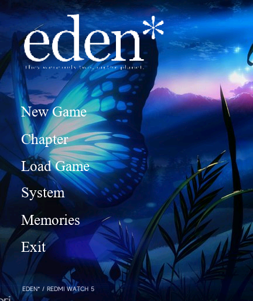

# 《eden》· 红米手表 5 图文移植

将用户提供的 Windows Steam 版《eden》中文剧情和静态画面转换为 Xiaomi Vela 应用。适配 REDMI Watch 5 的 432 × 514 屏幕，安装包以约 10 MB 为目标。工程由 Codex 完成资源分析、转换程序、阅读器实现和自动化检查，开发者负责需求、原作资源提供及后续实机测试。

## 当前发布与实机反馈

[下载 v0.1.4 安装包、源码与校验文件](https://github.com/xuanyide01/eden-rw5/releases/tag/v0.1.4)。安装包约 10.15 MB。

2026-10-20，维护者在 REDMI Watch 5 上反馈：**首次安装导致手表重启，再次安装成功，之后暂未发现其他问题。** 首次安装重启仍列为已知问题。维护者推测可能与**安装解包时峰值内存不足或系统负荷过高**有关，但尚未证实；目前没有设备崩溃日志，不能宣称已经修复，也不能据此保证其他固件不会重现。详细记录见 [实机反馈](reports/hardware-feedback014.json)。模拟器检查与这次用户实机反馈分别记录。



## 当前内容

- 正篇 21 章（序章、19 个中间章节与终章），8,860 条中文台词及旁白。
- 人物保留在原作预合成的场景画面中，保持原始人物与背景的对应关系。普通横向画面完整等比例显示；长幅画面在剧情中遵循原作镜头位置，在鉴赏中可查看全幅。
- CG 鉴赏包含 295 组、2,341 张静态图片；同场景差分合并，打开后点击切换。鉴赏列表保留每页 4 组的四宫格首图预览；查看图片时按原像素尺寸居中显示。标题、过场字卡和黑白幕不计入 CG 数量。
- 30 个可自行选择的存档位，覆盖确认、指定栏位读取和最近 8 步回退。
- 标题章节选择、菜单下一章；下一章保留剧情控制流程，遇到选择指令会停止。本作正篇源脚本没有玩家选择分支，不添加虚构路线。
- 文本自动换行、纵向滑动、24/28 像素字号、即时/逐字显示。滑动不推进剧情，滑动后重新轻点仍可推进。
- 菜单内自动播放与慢速／标准／快速三档速度。自动显示约 30 毫秒一字，完成后分别等待 2.6／1.5／0.8 秒；超过 60 字的段落额外等待。
- 57 张纯文字画面改为原生文本卡片，保留黑白配色和原图措辞，28 像素文字居中、自动换行；正篇实际使用其中 44 张。不再保存缩小的字形图片。阅读界面不显示内部章节代码，章节和存档列表使用中文章名。
- 原作紫灰色风格、白色剧情文字、统一的衬线标题按钮、圆形透明图标、标题退出应用。

不包含语音、音乐、音效、OP/ED 视频及完整动态演出。不运行 Windows EXE；这是面向手表的图文阅读器，并非在手表上模拟原引擎。CG 鉴赏默认开放。

## 压缩与包体

画面等比例缩至 264 像素宽，再以质量参数 56 编码为基准 JPEG。相近差分复用底图并叠加一个局部矩形图片，最多两层，避免将每一张差分重复保存成完整背景。没有把人物单独压成低色数图。字体只补充当前中文系统字体缺少的字符。

普通图片合并为 778 个有边缘留白保护的 JPEG 图集，文字卡只保留字符串和黑白背景参数，共享两张空白底图。JPEG 图集最大 280 × 512，每个图集最多约 0.55 MiB 的 RGBA 解码数据。普通 CG 和差分只是裁切显示图集中相应的矩形，未将其他场景内容显示到画面中。相比最初的两千多个独立图片，减少了文件系统块分配的开销；包体大小并不等同于设备实际占用空间。

具体字节数、SHA-256、解包大小和签名结果见 `reports/package-audit.json`。安装包以约 10 MB 为目标；为保留清楚的四宫格首图预览，构建上限设为 10 MiB（10,485,760 字节）。`.bin` 与 `.rpk` 的内容完全相同。

0.1.0 安装包为 9,800,657 字节，已通过 Vela 通用虚拟手表的全章序跳跃、章节首屏刷新、长文本滑动、CG 差分、指定存档读取、退出重开、冷启动和覆盖安装检查。首周目与通关后重读均逐条比对了全部 8,860 条源文本。0.1.0 的检查记录不代表后续版本已通过实机验证。

0.1.3 安装包为 **10,106,929 字节**，SHA-256 为 `f22c735e07453e4d7e5a261ba9855244c14e179625cc282720ebabfc60898f81`。22 项逻辑测试通过。0.1.3 针对用户报告的实机 CG 鉴赏崩溃／重启进行优化；后续 0.1.4 实机反馈见本文开头。

## 0.1.4 通关标题背景

当前 0.1.4 安装包为 **10,146,001 字节（约 10.15 MB）**，SHA-256 为 `121c1b645282735a3e7ea558b3946be9bdccf5bc10b545cbd0870aa56a53ca89`。

通关前保持原作建筑标题背景；正篇终章写入原作 `eden_D001 = 1` 标记后，返回标题改用 `sys.paz/topmenu1.png` 的蓝色蝴蝶背景。退出重开后保留，0.1.3 及更早版本已有的通关记录也会识别。章节浏览模式不单独写入全局通关记录。菜单布局、圆形应用图标、正文、存档键及四宫格鉴赏均保持不变。

蝴蝶背景排除原 PC 菜单后等比例裁为 432 × 514，仍只显示一个标题背景图片组件。24 项逻辑检查通过；未通关、终章完成、退出重开及旧通关记录覆盖更新分别检查。截图与当前版本检查报告见输出目录。

## 0.1.3 图标与鉴赏内存优化

应用列表的圆形图标改为用户提供图片的面部及花冠裁切；标题背景、标志和菜单图片保持不变，标题实屏像素与 0.1.2 一致。

旧版打开鉴赏时解析 251,842 字节的完整目录，并同时创建最多 8 个缩略图图层。新版将目录拆为 74 个小分页，每次最多读取 4,510 字节，列表仅加载当前页 4 组的首图合成预览（198 × 184），只创建一个图片组件；仅保留当前页 4 组的少量索引，其他差分在打开对应组后逐张加载。退出和切页时释放旧目录、图层及定时器，并按平台能力进行有节制的垃圾回收。

单图查看保持完整画面与全部差分，按资源原像素大小居中，不再放大整张图集。单层图片源最大 280 × 512，最多两层；仅图片源的 RGBA 解码数据上限为 1,146,880 字节，该数字不包括系统、框架、缓存等其他开销。切换前先移除旧图层，等待解码完成后才允许下一次切换；出错可返回列表。图片显示面积较旧版缩小，是为降低实机内存风险作出的取舍。

模拟器压力检查已连续进出鉴赏 12 次、完成 93 次差分切换，包含最大分组的全部 75 张；预热后反复进入未观察到内存继续增长。

尚未取得实机崩溃日志，不能确认旧版唯一故障原因，也不能以模拟器通过宣称已完全解决所有固件上的重启。具体改动、测试及复测方法见 [鉴赏优化说明](reports/gallery013-notes.md)。

## 保留的文字画面与阅读功能

0.1.1 仅识别了 `mozi_` 开头的文字图，漏掉了按剧情词句命名的同类画面，例如用户指出的 `B002_watashihane.png`。0.1.2 对全库纯文字画面逐张核对，将 57 张全部改为原生文本排版，不使用图片放大。原图文字可能与下方台词不同，两者分别保留，未直接复制当前台词代替原图内容。

文字卡保持白底黑字或黑底白字，在上方 432 × 270 区域居中显示，文字 28 像素、行高 38 像素、最大宽度 384 像素，长句自动换行。去除了阅读界面的内部章节代码，章节列表、存档信息及 CG 标签改为可读中文名称。纯文字卡从 CG 图片列表移除，照片和插画差分保留；因此鉴赏计数从 301 组／2,347 张调整为 295 组／2,341 张。

CG 与文本框之间的白色装饰线继续移除。普通图片仍使用 264 像素宽、JPEG 质量 56，没有为此次修改进一步降低普通画面的画质。详细说明见 [文字卡与画面说明](reports/visual012-notes.md)。

开启自动播放后返回正文即可运行。菜单、存读档、手指按住正文、滑动阅读及切到后台时暂停，恢复正文后重新计时。遇到选择需手动选择，之后继续；本作正篇源脚本没有玩家选择，选择暂停逻辑另用测试剧情验证。点击“上一句”、返回标题、剧情结束或错误会关闭自动。速度档位保存在本地，应用重开时自动播放默认关闭。超过 60 字的部分每字增加 55 毫秒等待，最多增加 5 秒。

原作脚本存在 24 处镜头移动请求。当前采用各移动请求的目标镜头静态帧，未复现中间平滑移动，因此部分上下或左右切换会显得突然。本次还修正了 `ev016a01_mugai.png` 因同为 16:10 而误用全幅缩图的问题，改为原作 1024 × 640 镜头窗口。具体证据和已实现范围见 [画面与镜头说明](reports/visual012-notes.md)。

此版本保持全部 8,860 条正文的章节、指令位置与文字摘要一致，应用标识和存档键未变，覆盖安装保留已有存档；卸载仍可能清除存档。

## 安装与故障处理

1. 在手机的“表盘自定义工具”中选择 `.bin`，将应用传输到红米手表 5。
2. 蓝牙传输完成后，手表还需要处理安装；请继续等待，避免连续重复传输。
3. 从应用列表打开《eden》。0.1.4 已收到用户实机反馈：第一次安装触发重启，第二次安装成功，之后暂未发现其他异常；安装阶段问题仍未定位。Vela 模拟器不等同于特定手表固件。

如果安装过程中手表重启，先等待系统正常启动并确认应用是否已安装，避免连续重复传输。若反复重启，应停止重复安装。

如打开后异常，可先正常退出并重新打开，仍异常时重启手表、单独重新安装本应用。不要连续覆盖安装不同测试包。卸载通常会清除本应用存档。

如果随后连先前正常的应用也无法安装，先重启手表和手机工具，确认系统及工具状态；此前其他游戏曾出现安装服务异常、重置后恢复的情况，不能据此断定本作一定需要重置。恢复出厂设置应作为最后手段，并提前同步可保留的数据；它会清除本地应用和存档。本应用不提供固件写入或系统分区操作。

## 本地构建

Node.js 与 Python 3，安装转换依赖及兼容编译器：

```powershell
python -m pip install -r requirements.txt
npm install --ignore-scripts
npm install --prefix tools/compat-toolkit --ignore-scripts
$env:EDEN_GAME_ROOT = 'C:/Games/eden'
$env:EDEN_IMAGE_QUALITY = '56'
python tools/convert.py
python tools/build-ui.py
python tools/build-text-font.py '自己的/NotoSansMonoCJKsc-Regular.otf' --default-font '自己的/Vela默认字体.ttf'
npm test
npm run build
python tools/audit-source.py
python tools/audit-visual014.py
$env:EDEN_DEFAULT_FONT = '自己的/Vela默认字体.ttf'
python tools/audit-package.py
```

转换器仅解析字面量指令，未支持的源指令会中止转换。`paz.py` 只读解析归档。`convert.py` 检查标签、章节链接和所有源台词；`audit-source.py` 独立逐行回放初次及通关后的原脚本，验证剧情顺序。默认字体仅用于本地覆盖分析，不包含在源码包中；如已有生成后的字体及剧情资源，普通重建不需要原游戏目录或默认字体。再次进行字形覆盖校验时，通过 `EDEN_DEFAULT_FONT` 指向本地默认字体。

兼容编译器固定为 aiot-toolkit 1.1.0，构建后重新封装为此前设备测试中使用的兼容 ZIP 尾部格式，并校验内外签名、文件摘要和资源原始字节。模拟器是官方 Vela Watch 5 通用镜像，不是红米手表 5 固件。启动方法见 `tools/start-emulator.ps1`。

## 署名与授权

- 原作《eden》：minori；图像、剧情、名称和标志的权利属于原权利人。提供的安装目录包含中文脚本及中文补丁，译文权利属于对应译者；当前目录未包含可核实的译者署名，不自行杜撰。
- 借鉴的腕上视觉小说作品：[@liuyuze61 的《ATRI》1.5.1](https://api.bandbbs.cn/wftools/bandbbs.html?code=A&state=1820673)、[@liuyuze61 的《星空列车与白的旅行》v1.0.0](https://api.bandbbs.cn/wftools/bandbbs.html?code=A&state=1841662)。
- 感谢[表盘自定义工具及相关团队](https://www.bandbbs.cn/)提供安装工具。
- PAZ 格式分析参考 [GARbro 的 Musica/PAZ 实现](https://github.com/morkt/GARbro/blob/master/ArcFormats/Musica/ArcPAZ.cs) 和 [Inori/FuckGalEngine 的 Steam《eden》参数表](https://github.com/Inori/FuckGalEngine/blob/master/Minori/Minori/fuckpaz/main.cpp)。
- 字体 Noto Sans Mono CJK SC：SIL OFL 1.1，许可见 `licenses/NotoSansCJK-OFL.txt`。

自编阅读器及转换代码采用 MIT；这不授予原游戏素材、译文、原作标志、系统字体或第三方工具的再授权。源码压缩包排除原始 PAZ、原游戏 EXE/DLL、私钥、依赖目录、构建缓存和模拟器用户数据。


## 联系方式

问题反馈与交流：[shining237841@gmail.com](mailto:shining237841@gmail.com)。
